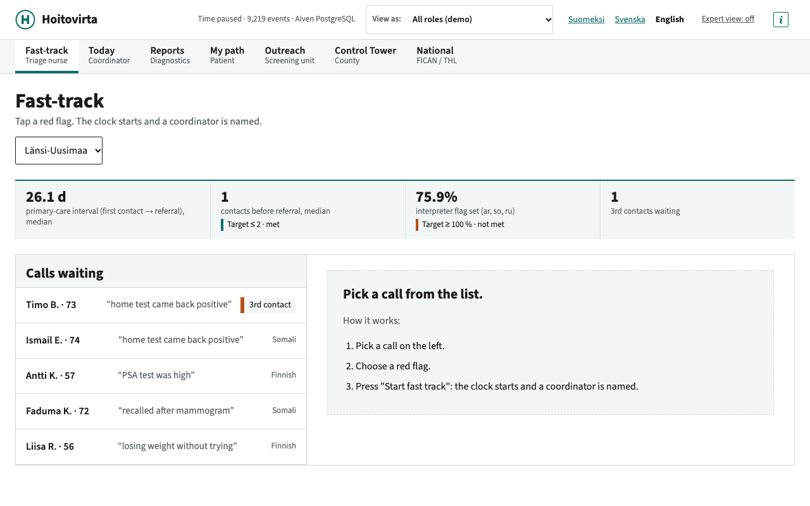
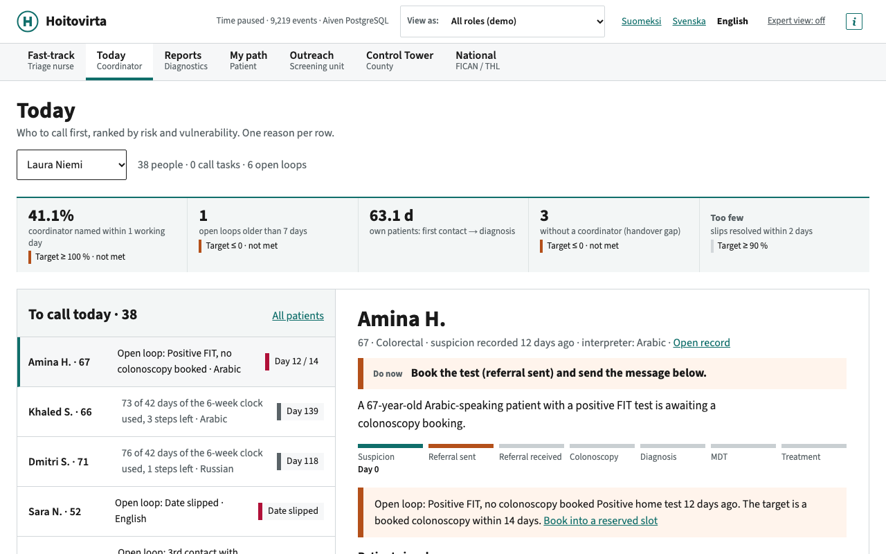
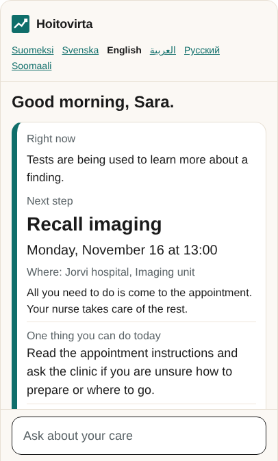
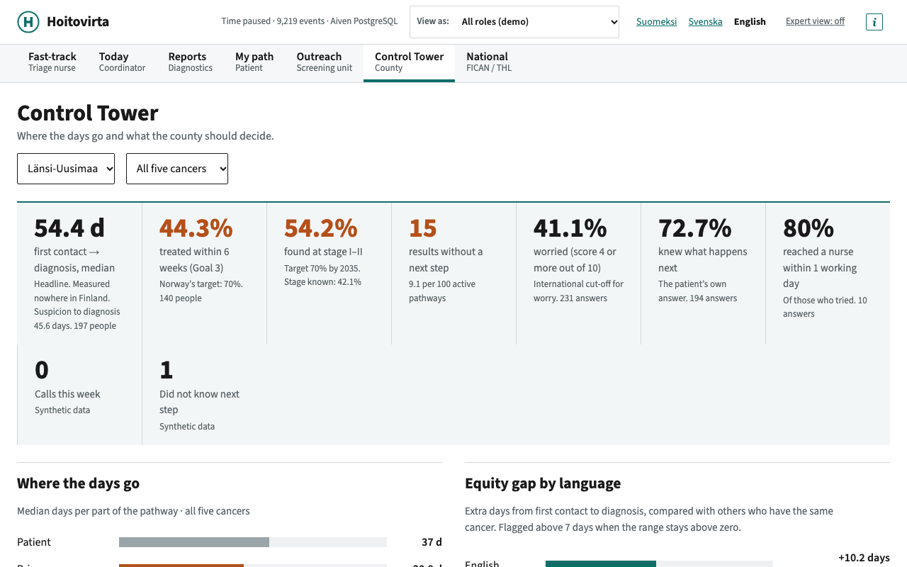
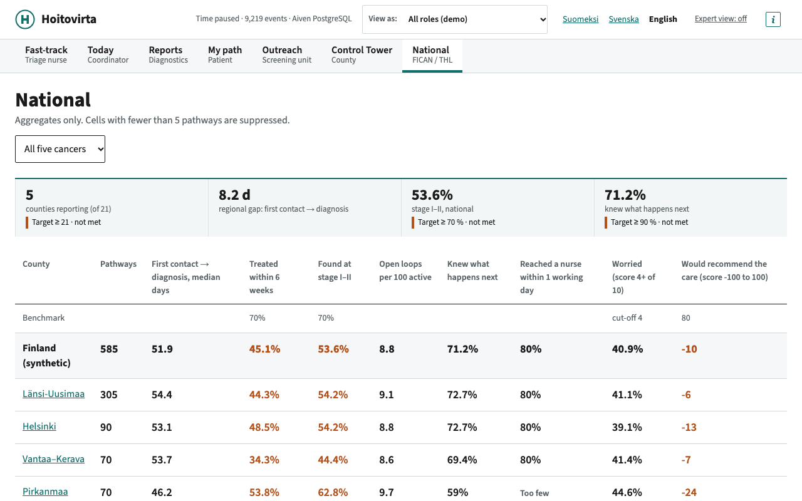

# Hoitovirta

**Hoitovirta means "care flow".** It gives every person with a suspected cancer the same fast, clear road to a diagnosis, whatever their language, income or address.

Built for Junction 2026, AstraZeneca challenge **Equal Care Across Finland**.

| | |
|---|---|
| Live demo | https://majormask--hoitovirta-web.us-east.modal.run (no login) |
| Video | https://youtu.be/wNoiuXIck-0 |
| Source code | https://github.com/MajorMask/hoitovirta |
| Slides | [`docs/hoitovirta-deck.pdf`](docs/hoitovirta-deck.pdf) |
| Every number and its source | [`docs/EVIDENCE.md`](docs/EVIDENCE.md) |
| How it works | [`docs/ARCHITECTURE.md`](docs/ARCHITECTURE.md) |
| Pilot proposal | [`docs/PILOT.md`](docs/PILOT.md) |

> **All patient data in this repository is synthetic.** No real people. Every screen says so.

## The problem in three facts

1. **Finland does not measure the wait before a referral.** The official six-week clock starts when a referral arrives (THL 21/2016). The time from first contact to diagnosis is measured nowhere.
2. **The wait is long.** In lung cancer, about 155 days from first symptom to treatment in Finland and 67 in Denmark (preliminary study, Yle MOT, Oct 2026).
3. **It is not equal.** Breast screening reaches 87% of women with a job and 60% without; 82% of women who speak Finnish or Swedish and 63% of women who speak another language; 85% with higher education and 66% with lower (2020–21, OECD/EC 2025). Five-year survival is about 77% with higher education and 64% with lower.

## What it does

One web app, seven screens, one shared record. A tap on one screen shows on the others within seconds.

| | |
|---|---|
|  | **Triage nurse, Fast-track.** One tap on a red flag starts the clock and names a coordinator. |
|  | **Coordinator, Today.** Who to call first, the open loops nobody owns, a reserved slot and a message in the patient's language. A person approves it. |
|  | **Patient, My path.** Next step, date and a named nurse, in the patient's own language. A high worry score asks the nurse to call that day. |
|  | **County manager, Control Tower.** Days from first contact to diagnosis, where the days go, the gap by language, a 14-day forecast and three suggested board decisions with sources. |
|  | **National view.** Counties side by side. Groups under five people are hidden. |

Two more screens: **Reports** (diagnostics: a report becomes structured fields with a confidence score) and **Outreach** (screening unit: non-responders by language).

## Try it in two minutes

1. Open the live demo. In the footer, open **Demo controls** and press **Reset demo**. Choose **English** in the header.
2. **Fast-track:** pick a call, tick one red flag, press **Start fast track**. The banner names a coordinator.
3. **Today** (coordinator Laura Niemi): open **PW-D1, Amina H.**, who speaks Arabic and had a positive home bowel test 12 days ago with no colonoscopy booked. Press **Book into a reserved slot**, choose a time, then **Approve and send**.
4. **My path:** under "Demo: view as", pick **Sara N. (PW-D5)** for English or **Amina H. (PW-D1)** for Arabic. See the next step, date and nurse in the patient's own language. Ask a question or use a worry button: the nurse is told.
5. Open **Control Tower**, then **National**, to see the same data as a county manager and as a national reader.
6. Optional, before anyone is ill: open the **Patient check-in survey (demo)** link in the footer (`/pulse-lab/`, Finnish, Swedish or English). **Upcoming free screening** shows the three programmes with sources. Answer "I worry it costs money" and the **Care-team view** shows a follow-up task. This survey is a separate prototype with synthetic data only.


### The five demo patients

| Number | Patient | Language | Story |
|---|---|---|---|
| PW-D1 | Amina H., 67 | Arabic | Positive home bowel test 12 days ago, no colonoscopy booked |
| PW-D2 | Matti K., 64 | Finnish | Third contact for back pain, no protein test booked |
| PW-D3 | Juha L., 58 | Finnish | Lung nodule on a scan, no follow-up CT booked |
| PW-D4 | Pekka V., 69 | Swedish | Raised PSA, 25 days in, waiting for the diagnosis step |
| PW-D5 | Sara N., 52 | English | Abnormal mammogram, her imaging date was moved |

## What the AI does, and where it stops

- It **drafts** messages in the patient's language, **reads** report text into fields, and **explains** the next step to the patient.
- It never diagnoses. It never starts the clock: only a clinician's tap does. It never sends a message on its own.
- Emergency words skip the model and show a fixed message that says to call 112.
- The priority list is a plain rule with a stated reason on every row.
- If no model answers, templates take over and the app still works.

Details and the full table are in [`docs/ARCHITECTURE.md`](docs/ARCHITECTURE.md).

## Honest limits

A prototype, not a medical device. No real hospital connection. The red flags and procedures are examples to be reviewed by clinicians. Finnish, Swedish, Arabic, Russian and Somali texts need native review. The pilot goal (about 45 days less in lung cancer, half of the 88-day gap to Denmark) is **our target, not a result**. The risk-score weights are hand-set until pilot data exists.

## Run it yourself

```bash
python3 -m venv .venv && .venv/bin/pip install -r requirements.txt pytest httpx2
.venv/bin/python -m uvicorn api.main:app --port 8000     # SQLite is used if DATABASE_URL is not set
.venv/bin/python -m pytest -q                            # tests
```

Open http://localhost:8000. Optional keys go in `.env` (see `.env.example`; never commit it): `DATABASE_URL` for Aiven PostgreSQL, `VERDA_*` for Nemotron, `FEATHERLESS_API_KEY`, `GEMINI_API_KEY`, `ELEVENLABS_API_KEY`. With no keys the app still runs.

Deploy: `bash setup.sh` once, then `python3 -m modal deploy modal_app.py`.

## Bring a county's own data

```bash
python standard/validate.py ingest/samples/ehr_export.csv
curl -X POST localhost:8000/api/ingest/ehr-csv --data-binary @ingest/samples/ehr_export.csv -H 'content-type: text/csv'
```

The event standard is in `standard/schema.sql`. Adapters for EHR CSV and FHIR Bundle are in `ingest/`. Importing the same export twice adds nothing.

## Built with

Python and FastAPI, plain JavaScript, an append-only event store on Aiven PostgreSQL, one container on Modal, NVIDIA Nemotron on Verda with Gemini and open models as fallbacks, and an ElevenLabs voice agent.

Developed with AI coding assistance (OpenAI Codex and Claude Code); design decisions, review and testing by the team.

## Read next

[`docs/EVIDENCE.md`](docs/EVIDENCE.md) · [`docs/PILOT.md`](docs/PILOT.md) · [`docs/PULSE-INSTRUMENT.md`](docs/PULSE-INSTRUMENT.md)
