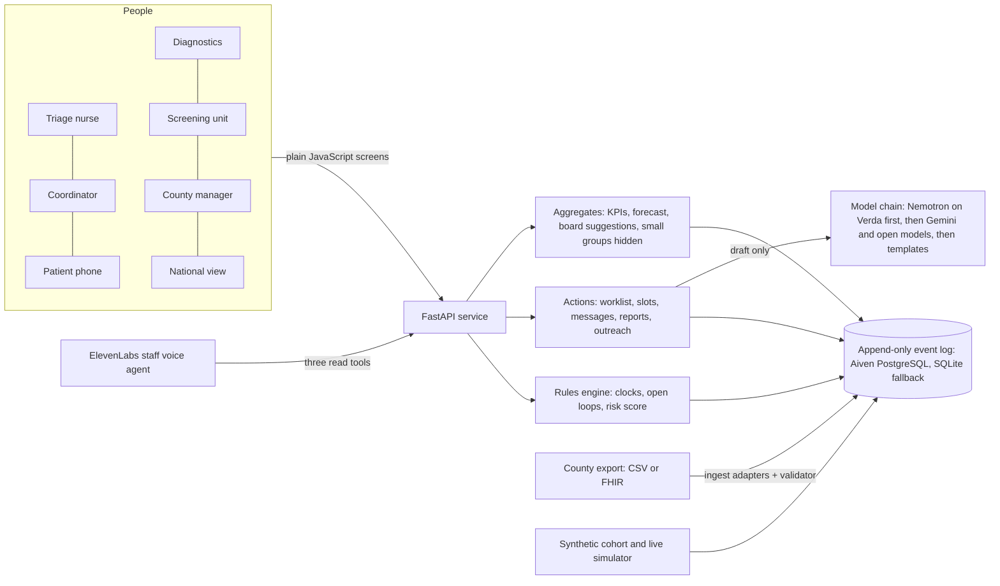

# How Hoitovirta works

One web app, one event log. Every screen reads from the same log, so a tap on one screen shows on the others within seconds.



## The clock

Each pathway is a list of timestamped events. The names are fixed in `standard/schema.sql`.

| Event | Meaning | Who writes it |
|---|---|---|
| S0 | Symptom onset, as told by the patient | Patient check-in |
| C1 | First contact about the complaint | System, from the contact record |
| T0 | Suspicion recorded | **A clinician, with one tap in Fast-track. Nothing else can write it.** |
| T1 to T3 | Referral sent, referral received, first test | Hospital systems or the coordinator |
| T4 | Diagnosis | A person confirms it |
| T5, T6 | Team meeting, treatment | Hospital systems |

Headline measure: days from first contact (C1) to diagnosis (T4). Finland measures the clock only from referral arrival (THL 21/2016), so this interval is not measured anywhere today.

## Where AI is used, and where it stops

| Where | What it does | What keeps it safe |
|---|---|---|
| Coordinator message drafts | Writes the message in the patient's language | A person reads and approves every message. Somali needs a tick that someone who reads Somali has checked it. |
| Report reader | Pulls fields out of report text with a confidence score | Doubtful fields go to a check queue. Diagnosis and stage are written only after a person confirms. |
| Patient companion | Explains the next step, helps prepare questions, notices worry | Emergency and self-harm words skip the model and show a fixed message that says to call 112. Answers must pass a grounding check against the patient's own record and approved text. It can add a suggestion or a task for the nurse. It cannot start the clock, change a date or diagnose. A template answers if the model is slow or down. |
| Staff voice agent | Lets a coordinator ask about a patient by phone | Three read tools only: verify staff, patient status, procedure lookup. Staff are verified first. The call summary arrives through a signed webhook. |

The priority list and the risk score are plain rules with hand-set weights, and each row shows its reason. They are to be calibrated on pilot data, not trusted as they are.

The model chain tries providers in order and falls back to templates: NVIDIA Nemotron on Verda first, then Gemini and open models (Gemma, Qwen), then offline templates. With no keys at all, the app still runs.

## Privacy by design

- Prototype data is 100% synthetic and every screen says so.
- National and county views show aggregates only. A group with fewer than five pathways is hidden.
- A role switcher ("View as") limits what each role can read. Patient and family views are tied to one pathway through a signed token. This is a demo mechanism, not a login.
- Nothing here is certified or compliant with any regulation. A real pilot needs a data protection impact assessment and clinical sign-off on every red flag and procedure.

## Bring a county's own data

An open event standard (`standard/schema.sql`), a validator (`standard/validate.py`) and two adapters (EHR CSV and FHIR Bundle) turn a county export into pathways. Re-running the same export adds nothing, so it is safe to repeat.

```bash
python standard/validate.py ingest/samples/ehr_export.csv
```

## Code map

| Folder | Purpose |
|---|---|
| `api/` | FastAPI service, serves `web/` |
| `web/` | Plain JavaScript screens in Finnish, Swedish, English and more |
| `engine/` | Clocks, open loops, risk score, check-in rules |
| `act/` | Worklist, slots, messages, reports, outreach, companion |
| `aggregate/` | KPIs, forecast, board suggestions, small-group hiding |
| `store/` | Append-only event store |
| `sim/` | Synthetic cohort and live simulator |
| `ingest/`, `standard/` | Import adapters, event standard, validator |
| `app/`, `voice/`, `companion/` | Model chain, voice agent, companion policy |
| `pulse_service/` | A separate prototype of the check-in survey service. It is not part of the main app |
| `tests/` | Companion, check-in, reset and access tests |
